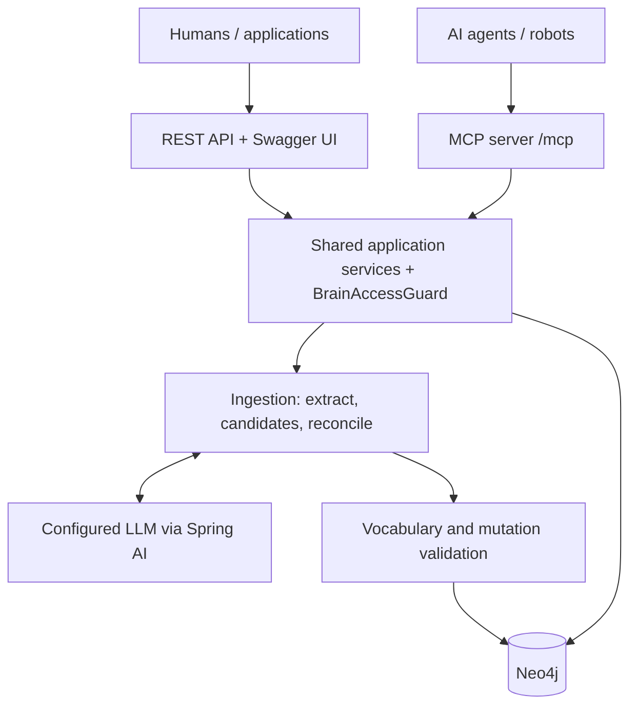

# GraphSpindle

*Weaving information into intelligence.*

GraphSpindle is an open-source, self-hostable, LLM-powered knowledge graph engine for building and maintaining independent digital brains. It accepts unstructured information from humans, AI agents, robots and other applications, and turns the useful parts into a coherent, evolving graph in Neo4j.

An agent sends a conversation, note, observation or document summary without knowing any graph schema. GraphSpindle's own configured LLM proposes typed operations (new entities, facts, corrections); the engine reconciles them with what the brain already knows, validates them against a bounded vocabulary and writes them with provenance. Clients read the knowledge back through REST or MCP. Nobody writes Cypher.

- One Spring Boot application: REST API + Swagger UI + MCP server (Streamable HTTP), backed by Neo4j.
- Multiple independent **brains**, isolated from each other, each with its own configuration and vocabulary.
- A controlled vocabulary (`src/main/resources/vocabulary/core-v1.yml`): the model cannot invent labels, relationships or properties.
- Knowledge and **references**, not dumps: raw content is not stored by default, files and URLs are never fetched.
- Contradictions become conflicts instead of silent overwrites; every fact keeps its provenance; history and point-in-time reads.
- Per-brain API keys; REST and MCP share the same services, authorization and brain boundaries.



Design documents: [architecture](docs/ARCHITECTURE.md), [graph schema](docs/SCHEMA.md), [decisions (ADRs)](docs/DECISIONS.md), [implementation plan](docs/IMPLEMENTATION_PLAN.md), [integration notes](docs/INTEGRATION_NOTES.md), [agent instructions](AGENTS.md).

## Status: verified vs. untested

Milestones M1–M10 of the [implementation plan](docs/IMPLEMENTATION_PLAN.md) are implemented. `./mvnw verify` runs the unit tests and the integration tests against an **in-process Neo4j** (neo4j-harness 2026.10) with a **scripted fake LLM**, so:

| Verified by automated tests | Not verified (examples / untested) |
|---|---|
| Brains, vocabulary and node-type CRUD, manual knowledge, corrections, merges, conflicts, retrieval, `asOf` and history | `Dockerfile` and `compose.yaml` (Docker was not available on the development machine) |
| Ingestion pipeline, idempotency, prompt-injection handling, conflict policies (with the fake model) | The `openai`, `openai-compatible` and `anthropic` providers against the real services (no keys); only bean selection is tested |
| MCP tools and REST/MCP parity (MCP Java SDK client) | Provider-native structured output (`$defs`/`$ref` JSON schema) on OpenAI and Anthropic, so it is off by default for them |
| API key authentication and per-brain authorization over REST and MCP, rate limits, startup safety, Host/Origin checks, log redaction | Behaviour behind reverse proxies (`X-Forwarded-*` is not trusted) |
| Provider selection for `ollama` / `openai` / `anthropic` / `none` (context starts, no network) | Ingestion quality of a particular model; earlier manual runs used a local Ollama `gemma4:12b` (opt-in live tests, skipped by default) |

## Quick start (local JDK + Neo4j)

Requirements: Java 21, a Neo4j 5.x / 2026.x server (Community is enough), optionally [Ollama](https://ollama.com) for ingestion.

```bash
# 1. Neo4j listening on bolt://localhost:7687 (any local install)
# 2. an admin key: required for any non-loopback bind, and the only way to create brains and keys
export GRAPHSPINDLE_ADMIN_API_KEY="$(openssl rand -base64 32)"
export GRAPHSPINDLE_NEO4J_PASSWORD='your-neo4j-password'
# 3. optional: local LLM for ingestion
ollama pull gemma4:12b
export GRAPHSPINDLE_LLM_PROVIDER=ollama        # or: SPRING_PROFILES_ACTIVE=ollama
# 4. run (binds to 127.0.0.1:8080 by default)
./mvnw spring-boot:run
```

Then (all requests need the key, except `/actuator/health`):

```bash
H="X-API-Key: $GRAPHSPINDLE_ADMIN_API_KEY"
curl -s -H "$H" -H 'Content-Type: application/json' localhost:8080/api/v1/brains \
     -d '{"id":"dev","name":"Development"}'
curl -s -H "$H" -H 'Content-Type: application/json' localhost:8080/api/v1/brains/dev/ingestions \
     -d '{"content":"I am building GraphSpindle in Java. It uses Neo4j and Spring AI. I decided to use Apache 2.0."}'
curl -s -H "$H" 'localhost:8080/api/v1/brains/dev/search?q=GraphSpindle'
curl -s -H "$H" localhost:8080/api/v1/system/info
```

Build and test: `./mvnw verify` (needs no Neo4j, Docker or LLM; the ITs start an in-process Neo4j).

## Quick start (Docker Compose, untested)

```bash
cp .env.example .env     # set GRAPHSPINDLE_ADMIN_API_KEY and GRAPHSPINDLE_NEO4J_PASSWORD
docker compose up -d                       # app + Neo4j
docker compose --profile ollama up -d      # + an Ollama container; set GRAPHSPINDLE_LLM_PROVIDER=ollama and
                                           #   GRAPHSPINDLE_OLLAMA_BASE_URL=http://ollama:11434 in .env, then
docker compose exec ollama ollama pull gemma4:12b
```

`compose.yaml` publishes every port on `127.0.0.1` only (app 8080, Neo4j 7474/7687, Ollama 11434). Inside the container the app listens on `0.0.0.0`, so it refuses to start without `GRAPHSPINDLE_ADMIN_API_KEY`. The `Dockerfile` is multi-stage (JDK 21 build, JRE 21 runtime, non-root user). **These files follow standard syntax but were never run.**

## Configuration

All settings are Spring properties with environment-variable defaults in `src/main/resources/application.yml`; [`.env.example`](.env.example) lists every `GRAPHSPINDLE_*` variable.

### Neo4j

| Variable | Default | Notes |
|---|---|---|
| `GRAPHSPINDLE_NEO4J_URI` | `bolt://localhost:7687` | |
| `GRAPHSPINDLE_NEO4J_USERNAME` / `_PASSWORD` | `neo4j` / empty | empty password = no auth (local development only) |

GraphSpindle never exposes Neo4j or Cypher. Constraints and indexes are created at startup.

### LLM providers

Exactly one chat provider is active (`spring.ai.model.chat`). Select it with `GRAPHSPINDLE_LLM_PROVIDER` or a Spring profile (`SPRING_PROFILES_ACTIVE=ollama|openai|openai-compatible|anthropic|none`, files `application-<profile>.yml`).

| Provider | Setting | Data leaves the machine? | Status |
|---|---|---|---|
| `ollama` (local default) | `GRAPHSPINDLE_OLLAMA_BASE_URL` (`http://localhost:11434`), `GRAPHSPINDLE_OLLAMA_MODEL` (`gemma4:12b`) | no, if the base URL is local | bean selection tested; manually exercised with gemma4:12b |
| `openai` | `GRAPHSPINDLE_OPENAI_API_KEY`, `GRAPHSPINDLE_OPENAI_MODEL` (`gpt-4.1-mini`), base URL `https://api.openai.com/v1` | **yes** | bean selection tested only |
| `openai-compatible` (profile) | `GRAPHSPINDLE_OPENAI_BASE_URL` **including `/v1`**: LM Studio `http://localhost:1234/v1`, vLLM `http://localhost:8000/v1`, llama.cpp server, Groq `https://api.groq.com/openai/v1`; empty key = no auth | only for remote URLs | untested |
| `anthropic` | `GRAPHSPINDLE_ANTHROPIC_API_KEY`, `GRAPHSPINDLE_ANTHROPIC_MODEL` (`claude-sonnet-5-5`) | **yes** | bean selection tested only |
| `none` (default) | | no | ingestion answers 503 `LLM_UNAVAILABLE`; everything else works |

**Data transfer:** with a remote provider, the content you ingest (and candidate snippets of the brain's existing knowledge) is sent to that provider. `GET /api/v1/system/info` reports the active provider, model, host and `dataLeavesMachine`.

Provider-neutral settings: `GRAPHSPINDLE_LLM_MODEL` (per-call override), `GRAPHSPINDLE_LLM_CONTEXT_TOKENS` (32768; prompts that would not fit are refused, never truncated), `GRAPHSPINDLE_LLM_MAX_OUTPUT_TOKENS` (4096), `GRAPHSPINDLE_LLM_CALL_TIMEOUT` (90s), `GRAPHSPINDLE_LLM_TIMEOUT` (120s per ingestion), `GRAPHSPINDLE_LLM_STRUCTURED_OUTPUT`: `AUTO` (default: our JSON schema as Ollama's `format`, schema only in the prompt for every other provider, because the `$defs`/`$ref` schema was not verified against OpenAI or Anthropic), `PROVIDER_SCHEMA` or `PROMPT`. Keys come only from the environment.

### Security

| Variable | Default | Notes |
|---|---|---|
| `GRAPHSPINDLE_BIND_ADDRESS` | `127.0.0.1` | anything else requires the admin key |
| `GRAPHSPINDLE_ADMIN_API_KEY` | empty | bootstrap admin, ≥ 32 characters; only its hash is kept; never logged |
| `GRAPHSPINDLE_SECURITY_ENABLED` | `true` | `false` (no auth, everyone is admin) is refused unless bound to loopback |
| `GRAPHSPINDLE_API_DOCS_ACCESS` | `AUTO` | Swagger UI / `/v3/api-docs`: open on loopback, key required otherwise; `PUBLIC`, `AUTHENTICATED` |
| `GRAPHSPINDLE_ALLOWED_HOSTS` / `_ORIGINS` | localhost, 127.0.0.1, [::1] on any port | Host/Origin allowlist (DNS rebinding); add your hostname when exposing the server |
| `GRAPHSPINDLE_RATE_LIMIT_REQUESTS` / `_INGEST` / `_FAILED_AUTH` | 300 / 30 / 20 per minute | in memory, per instance |

### Vocabulary, API and MCP

| Variable | Default | Notes |
|---|---|---|
| `GRAPHSPINDLE_VOCABULARY_LOCATION` | empty | YAML merged over the bundled `core-v1.yml` by name, e.g. `file:/etc/graphspindle/vocabulary.yml` (ADR-025) |
| `GRAPHSPINDLE_VOCABULARY_API_MUTABLE` | `true` | `false` makes the vocabulary API read-only (403) |
| `GRAPHSPINDLE_MAX_REQUEST_BYTES` | 1 MiB | 413 above it |
| `GRAPHSPINDLE_MCP_REQUEST_TIMEOUT` | `150s` | `remember` runs ingestion synchronously |
| `GRAPHSPINDLE_MCP_SESSION_IDLE_TIMEOUT` / `_MAX_SESSIONS` | `30m` / `1000` | |

Every `graphspindle.*` property in `application.yml` is listed here (`ConfigDocsTest` checks it): `graphspindle.security.enabled`, `graphspindle.security.admin-api-key`, `graphspindle.security.api-docs`, `graphspindle.security.allowed-hosts`, `graphspindle.security.allowed-origins`, `graphspindle.security.rate-limit.requests-per-minute`, `graphspindle.security.rate-limit.ingest-per-minute`, `graphspindle.security.rate-limit.failed-auth-per-minute`, `graphspindle.llm.enabled`, `graphspindle.llm.model`, `graphspindle.llm.temperature` (0.0), `graphspindle.llm.max-output-tokens`, `graphspindle.llm.context-tokens`, `graphspindle.llm.call-timeout`, `graphspindle.llm.timeout`, `graphspindle.llm.structured-output`, `graphspindle.ingestion.correction-cues` (words that mark an explicit correction, ADR-028), `graphspindle.mcp.session-idle-timeout`, `graphspindle.mcp.max-sessions`, `graphspindle.vocabulary.location`, `graphspindle.vocabulary.api-mutable`, `graphspindle.api.max-request-bytes`.

## Authentication and API keys

- Send a key as `X-API-Key: <key>` or `Authorization: Bearer <key>` on `/api/**`, `/mcp` and (off loopback) the docs.
- The **admin key** (`GRAPHSPINDLE_ADMIN_API_KEY`) can do everything: create brains and manage all keys.
- **Brain keys** look like `gsk_<keyId>_<secret>`. Each grants `READ`, `WRITE` (also ingestion, edits, conflict resolution) or `ADMIN` (also config, vocabulary, deletion, the brain's keys) on one or more brains. Only a SHA-256 hash of the secret is stored; the key is shown **once**.

```bash
# a WRITE key for brain dev (admin or a dev ADMIN key)
curl -s -H "$H" -H 'Content-Type: application/json' localhost:8080/api/v1/brains/dev/api-keys \
     -d '{"name":"my-agent","permission":"WRITE","expiresAt":"2027-01-01T00:00:00Z"}'
# a key for several brains (admin only)
curl -s -H "$H" -H 'Content-Type: application/json' localhost:8080/api/v1/api-keys \
     -d '{"name":"robot","grants":[{"brainId":"dev","permission":"WRITE"},{"brainId":"home","permission":"READ"}]}'
curl -s -H "$H" localhost:8080/api/v1/brains/dev/api-keys           # list (never secrets)
curl -s -H "$H" -X DELETE localhost:8080/api/v1/api-keys/<keyId>    # revoke everywhere (admin)
curl -s -H "$H" -X DELETE localhost:8080/api/v1/brains/dev/api-keys/<keyId>   # remove dev's grant
```

Responses: no, wrong, revoked or expired key → 401 `UNAUTHENTICATED`; a brain the key has no grant for → 404 `BRAIN_NOT_FOUND`, exactly like a brain that does not exist; too low a permission → 403 `FORBIDDEN`; over a rate limit → 429 `RATE_LIMITED`. Key management is REST-only (no MCP tools). Deleting a brain deletes its grants.

## REST API and Swagger

Swagger UI: `http://127.0.0.1:8080/swagger-ui.html`, OpenAPI JSON: `/v3/api-docs` (use **Authorize** with your key). Main resources under `/api/v1`:

- `brains` (create, list, get, `PATCH` config with `If-Match`, `DELETE ?confirm=<id>`), `brains/{id}/vocabulary`
- `brains/{id}/ingestions` (`POST` remember; `?dryRun=true`; `requestId` for idempotent retries), `GET .../ingestions/{ingestionId}`, `GET .../ingestions?requestId=`
- `brains/{id}/search?q=`, `entities`, `entities/{entityId}` (`?asOf=`, `?include=claims`), `entities/{entityId}/history`, `entities/{entityId}/neighbors`, `entities/merge`, aliases
- `brains/{id}/claims` (assert, `supersede`, `retract`, `history`), `sources`, `conflicts` (`resolve`)
- `node-types`, `relationship-types` (core) and `brains/{id}/node-types`, `brains/{id}/relationship-types` (CRUD)
- `api-keys`, `brains/{id}/api-keys`, `admin/brains/{id}/projection-check`, `system/info`

Errors are RFC 9457 problem details with a stable `code`.

### Node types

```bash
curl -s -H "$H" -H 'Content-Type: application/json' localhost:8080/api/v1/brains/dev/node-types \
     -d '{"name":"Recipe","description":"A dish and how to cook it","properties":[{"name":"cuisine","type":"STRING"}]}'
curl -s -H "$H" localhost:8080/api/v1/brains/dev/node-types/Recipe        # ETag = configVersion
curl -s -H "$H" -H 'If-Match: "2"' -X DELETE localhost:8080/api/v1/brains/dev/node-types/Recipe
```

Core types can be disabled (`PUT {"enabled": false}`) but not deleted; types still in use cannot be removed; names too similar to existing ones are refused. The operator YAML (`GRAPHSPINDLE_VOCABULARY_LOCATION`) is the place for permanent changes.

### History and point-in-time reads

`GET /api/v1/brains/dev/entities/{id}?asOf=2026-11-01T00:00:00Z` returns the entity as it was believed at that instant; `GET .../entities/{id}/history` lists every change (claims asserted, superseded, retracted, merges). Corrections never delete: superseded facts stay in the history with provenance.

### Files and URLs are references

GraphSpindle never reads files or fetches URLs. Pass a reference and your own summary:

```json
{"content": "Notes from the design review ...",
 "sources": [{"kind": "FILE", "locator": "/projects/gs/design.md", "title": "Design", "summary": "Decides on Neo4j",
              "mediaType": "text/markdown", "contentHash": "sha256:..."}]}
```

The source is stored as a `SourceRef` (locator, title, summary, hash) and linked to the facts it supports; the file content is not stored.

## MCP

The MCP server speaks Streamable HTTP at `http://127.0.0.1:8080/mcp` with 20 tools (`list_brains`, `get_brain`, `list_node_types`, `list_relationship_types`, `remember`, `get_ingestion`, `search_knowledge`, `list_entities`, `get_entity`, `get_entity_history`, `get_neighbors`, `list_claims`, `get_claim`, `get_claim_history`, `assert_claim`, `supersede_claim`, `retract_claim`, `list_conflicts`, `get_conflict`, `resolve_conflict`). Every tool takes an explicit `brainId`; results are wrapped as untrusted data. No STDIO transport (it would bypass authentication).

Example client configuration (Claude Code, `.mcp.json`; other clients that support HTTP MCP servers with custom headers are configured similarly; this snippet is an example, not a tested setup):

```json
{
  "mcpServers": {
    "graphspindle": {
      "type": "http",
      "url": "http://127.0.0.1:8080/mcp",
      "headers": { "Authorization": "Bearer ${GRAPHSPINDLE_AGENT_KEY}" }
    }
  }
}
```

Use a brain key with the least permission the agent needs (`READ` for retrieval only, `WRITE` to remember).

## Security notes and limitations

- Local-only by default (`127.0.0.1`). Expose the server only with the admin key set, behind TLS (a reverse proxy; GraphSpindle does not terminate TLS), and add your hostname to `GRAPHSPINDLE_ALLOWED_HOSTS`.
- Ingested text, graph content and model output are untrusted: the ingestion LLM has no tools, output is accepted only through the validator, evidence must quote the input, and brain ids, scopes and vocabulary never come from content.
- Rate limits and the `lastUsedAt` throttle are in memory and per instance. The client address for the invalid-key limit is the socket address.
- There are no stored global admin keys: rotate the admin key by changing the environment variable and restarting.
- Logs never contain keys, the `Authorization` header or ingested content at INFO.
- Not implemented: OAuth / MCP authorization spec, TLS, multi-instance deployments, cross-brain sharing, async ingestion, embeddings.

## License

Apache License 2.0.
