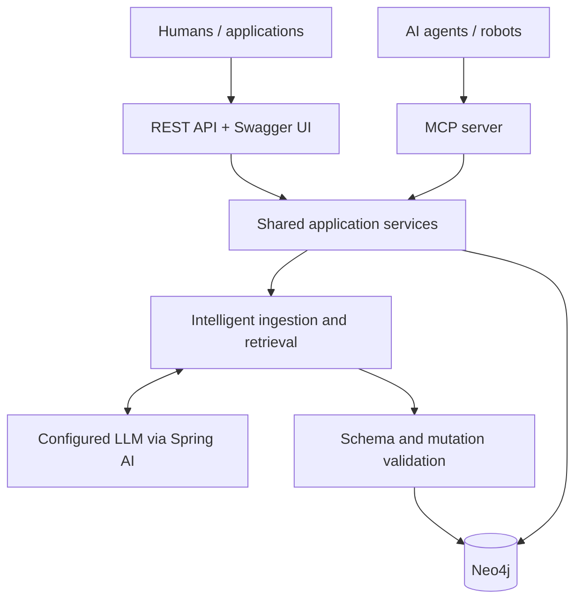

# GraphSpindle

*Weaving information into intelligence.*

GraphSpindle is an open-source, self-hostable, LLM-powered knowledge graph engine for building and maintaining independent digital brains. It accepts unstructured information from humans, AI agents, robots, and other applications, and turns useful information into a coherent, evolving graph.

## Vision

An external agent can send a conversation, note, observation, or document summary without knowing the graph schema. GraphSpindle uses its own configured LLM to extract durable knowledge, discover existing related nodes, and propose additions or updates. The application validates and persists those changes in Neo4j. Clients can later retrieve knowledge through the same interfaces.

- One Spring Boot application exposing REST APIs, OpenAPI/Swagger UI, and an MCP server.
- Neo4j for graph storage; an LLM is required for intelligent ingestion, with replaceable providers.
- Multiple independent brains, each with isolated knowledge and configurable rules.
- A controlled vocabulary of node and relationship types rather than unrestricted graph generation.
- Meaningful knowledge and references, not a dump of every conversation or file.
- No client needs to construct Cypher or understand the internal graph model.

## Example

An AI agent submits: “I am building GraphSpindle in Java. It uses Neo4j and Spring AI. I decided to use Apache 2.0.” The engine identifies the project, technologies and decision, checks for existing entities, and proposes a small set of validated graph changes. A later message can add new details to the same project rather than creating duplicates. A file can be represented by a reference and summary without copying its contents.

## Architecture

The diagram describes logical components in a single deployable application, not separate microservices. Raw information is untrusted input. The LLM proposes structured operations; validated application code performs graph writes.

## Project status

Design stage. This repository documentation defines the intended MVP, not implemented features or verified endpoints. See [architecture](docs/ARCHITECTURE.md), [implementation plan](docs/IMPLEMENTATION_PLAN.md), and [agent instructions](AGENTS.md).

## License

Apache License 2.0. Retain the LICENSE selected when creating the GitHub repository.
