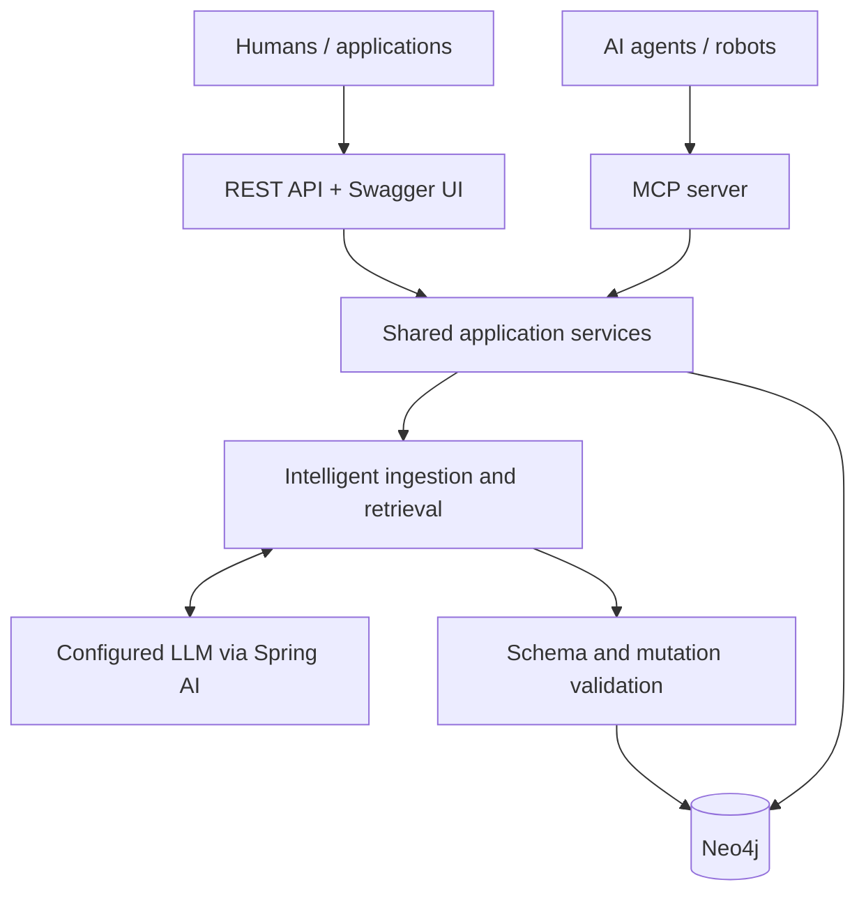

# GraphSpindle

*Weaving information into intelligence.*

GraphSpindle is an open-source, self-hostable, LLM-powered knowledge graph engine for building and maintaining independent digital brains. It accepts unstructured information from humans, AI agents, robots, and other applications, and turns useful information into a coherent, evolving graph.

## Vision

An external agent can send a conversation, note, observation, or document summary without knowing the graph schema. GraphSpindle uses its own configured LLM to extract durable knowledge, discover existing related nodes, and propose additions or updates. The application validates and persists those changes in Neo4j. Clients can later retrieve knowledge through the same interfaces.

- One Spring Boot application exposing REST APIs, OpenAPI/Swagger UI, and an MCP server.
- Neo4j for graph storage; an LLM is required for intelligent ingestion, with replaceable providers.
- Multiple independent brains, each with isolated knowledge and configurable rules.
- A controlled vocabulary of node and relationship types rather than unrestricted graph generation.
- Meaningful knowledge and references, not a dump of every conversation or file.
- No client needs to construct Cypher or understand the internal graph model.

## Example

An AI agent submits: “I am building GraphSpindle in Java. It uses Neo4j and Spring AI. I decided to use Apache 2.0.” The engine identifies the project, technologies and decision, checks for existing entities, and proposes a small set of validated graph changes. A later message can add new details to the same project rather than creating duplicates. A file can be represented by a reference and summary without copying its contents.

## Architecture

The diagram describes logical components in a single deployable application, not separate microservices. Raw information is untrusted input. The LLM proposes structured operations; validated application code performs graph writes.

## Project status

In development (milestones M1–M8 of the [implementation plan](docs/IMPLEMENTATION_PLAN.md)). Verified by integration tests against an in-process Neo4j: brain management and vocabulary configuration (core vocabulary in `src/main/resources/vocabulary/core-v1.yml`, overridable with `graphspindle.vocabulary.location`; node-type and relationship-type CRUD with guardrails, lockable with `graphspindle.vocabulary.api-mutable=false`), the graph store, and the manual knowledge and retrieval REST API under `/api/v1/brains/{brainId}` (entities, aliases, claims, corrections, merges, conflicts, search, plain entity views with `?asOf=` point-in-time reads and `/history`, entity context with `?include=claims`, neighbourhood, claim history, sources) plus `GET /api/v1/admin/brains/{brainId}/projection-check`. LLM ingestion (M6): `POST /api/v1/brains/{brainId}/ingestions` (and `GET .../ingestions/{id}`, `GET .../ingestions?requestId=`) runs extract → candidate lookup → reconcile → validation → one write transaction, with requestId idempotency, content-hash dedup, secret redaction and dry runs; verified offline with a scripted fake model. The provider is chosen with `GRAPHSPINDLE_LLM_PROVIDER=ollama|openai|anthropic|none` (default `none`: ingestion answers 503, everything else works); the local default is Ollama `gemma4:12b` at `http://localhost:11434` (`GRAPHSPINDLE_OLLAMA_MODEL`), OpenAI-compatible servers use `openai` with `GRAPHSPINDLE_OPENAI_BASE_URL` (include `/v1`), keys come only from `GRAPHSPINDLE_OPENAI_API_KEY` / `GRAPHSPINDLE_ANTHROPIC_API_KEY`. With a remote provider, ingested content is sent to that provider. Entity resolution (M7): alias, compact-name (case, spacing, punctuation, "The") and fuzzy fulltext candidate lookup; near-duplicate new entities open DUPLICATE_CANDIDATE conflicts (`config.duplicateSuspicionScore`, default 0.85) instead of being merged; conflict policies `EXPLICIT_CORRECTIONS_SUPERSEDE` (default), `ALWAYS_FLAG` and `LATEST_WINS` (verified with the fake model). MCP (M8): an MCP server over Streamable HTTP at `http://127.0.0.1:8080/mcp` with 20 tools (`remember`, `search_knowledge`, `get_entity`, `get_neighbors`, claim and conflict tools …, ARCHITECTURE §11) that call the same services as REST; verified with the MCP Java SDK client against REST (parity, brain isolation, prompt injection as data). Not implemented yet: authentication (M9); until M9 the REST API and the MCP endpoint have **no authentication** and must stay bound to localhost (the default). See [architecture](docs/ARCHITECTURE.md) and [agent instructions](AGENTS.md).

## License

Apache License 2.0. Retain the LICENSE selected when creating the GitHub repository.
